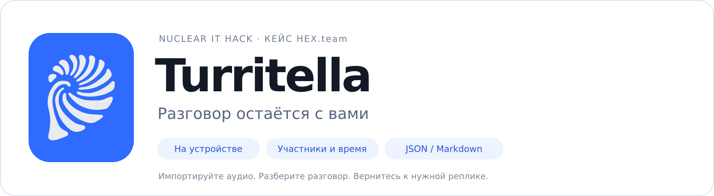
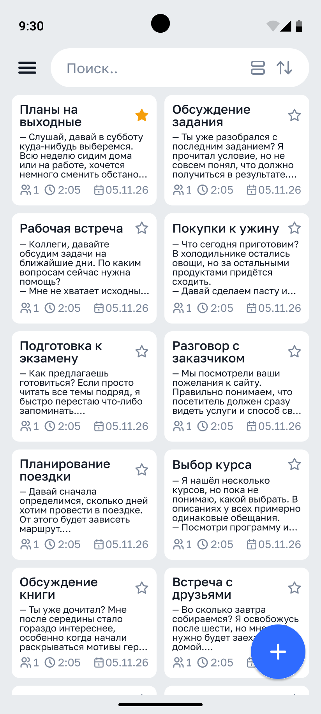
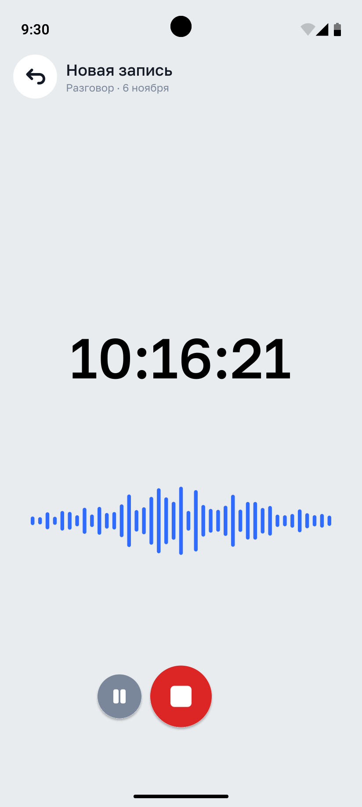
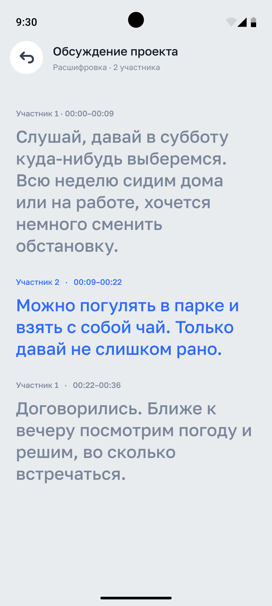
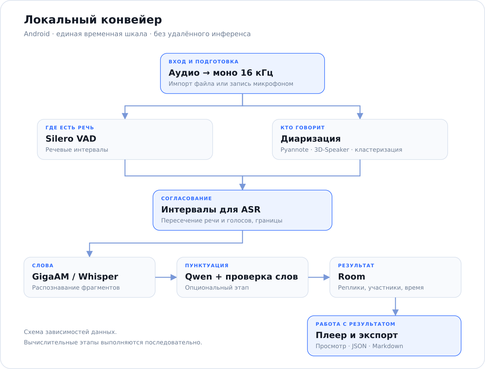

# Turritella



<p align="center">
  
  
  
  
</p>

<p align="center"><strong>Локальный стенографист для Android: текст, участники и временные метки прямо на телефоне.</strong></p>

<p align="center">
  <a href="#features">Возможности</a> ·
  <a href="#interface">Интерфейс</a> ·
  <a href="#architecture">Архитектура</a> ·
  <a href="#build">Запуск</a> ·
  <a href="#evaluation">Проверка качества</a>
</p>

Turritella превращает запись разговора в структурированную расшифровку. У каждой реплики есть текст, обозначение говорящего и временной интервал. К нужному месту можно перейти в плеере, а результат — сохранить в JSON или Markdown.

Проект разрабатывается для **Nuclear IT Hack от НИЯУ МИФИ, кейс HEX.team «Нейро-стенографист»**. Целевой объём — **средний уровень** из материалов кейса.

| Разобрать разговор | Вернуться к источнику | Сохранить контроль |
| --- | --- | --- |
| Реплики разделены по участникам | Нажатие на реплику переводит плеер к её началу | Распознавание, диаризация и пунктуация выполняются на устройстве |

**Статус.** Compose-интерфейс подключён к аудиоконвейеру, хранению, очереди обработки и MVI-логике в общей точке входа debug/release. Для выпуска APK по тегам настроен GitHub Actions; постоянный ключ подписи задаётся через Secrets. [Настройка релизов](docs/RELEASE.md).

<a id="features"></a>

## Возможности

Основной сценарий: **импортировать или записать аудио → обработать локально → просмотреть реплики → прослушать фрагмент → экспортировать результат**.

В реализации предусмотрены:

- Импорт аудиофайлов из памяти устройства и запись с микрофона с паузой и продолжением.
- Автоматическое выделение речи и разделение реплик по голосам.
- Временные метки относительно исходной записи.
- Восстановление пунктуации и регистра локальной LLM с проверкой сохранения слов.
- Этапы обработки, прогресс, отмена и повторный запуск.
- Воспроизведение, изменение скорости и переход к выбранной реплике.
- Локальная история, поиск по названию и тексту, переименование заметок и участников.
- Экспорт JSON по формату кейса и Markdown для чтения.

Наличие реализации в этом списке означает наличие кода; сквозная работоспособность подтверждается отдельным запуском на устройстве.

### Средний уровень: что реализовано

| Пункт из кейса | Решение в Turritella | Текущий статус |
| --- | --- | --- |
| Предварительная обработка аудио | Декодирование, моно, ресемплирование в 16 кГц; дополнительные DC/80 Гц/peak-фильтры | Подготовка формата включена; дополнительные фильтры реализованы и выключены до сравнения WER |
| Фильтрация пауз и неречевых фрагментов | Silero VAD; пересечение речевых интервалов с результатом диаризации | Реализовано; исходная временная шкала сохраняется |
| Устойчивое определение участников при смене реплик | Сегментация, эмбеддинги, кластеризация и сглаживание коротких переключений | Алгоритм реализован; устойчивость требует проверки на диалогах |
| Восстановление пунктуации | Qwen2.5-0.5B-Instruct и проверка последовательности слов | Реализовано, можно включать и выключать |
| Прогресс обработки | Стадии и проценты в состоянии заметки и foreground-уведомлении | Подключено к экрану расшифровки |
| Воспроизведение с переходом к реплике | Media3 ExoPlayer, перемотка к `startMs`, подсветка активной реплики | Подключено к ViewModel и экрану расшифровки |

Нейросетевое шумоподавление, разделение одновременной речи на независимые аудиосигналы и аппаратное ускорение не заявляются как готовые функции.

<a id="interface"></a>

## Интерфейс

<table>
  <tr>
    <th width="33%" align="center">Записи</th>
    <th width="33%" align="center">Запись разговора</th>
    <th width="33%" align="center">Расшифровка</th>
  </tr>
  <tr>
    <td align="center"><a href="docs/readme/screen-main.svg"></a></td>
    <td align="center"><a href="docs/readme/screen-recording.svg"></a></td>
    <td align="center"><a href="docs/readme/screen-transcript.svg"></a></td>
  </tr>
  <tr>
    <td align="center">История и поиск по заметкам</td>
    <td align="center">Запись, пауза и остановка</td>
    <td align="center">Участники, время и активная реплика</td>
  </tr>
</table>

*Предоставленные макеты из Figma в светлой теме. Тексты, даты и значения демонстрационные; изображения показывают дизайн интерфейса. Нажмите на экран, чтобы открыть исходный SVG.*

[Открыть проект в Figma](https://www.figma.com/design/8BSujn5ZYzhyfhggu5RsnC/my_projects?node-id=387-2453)

Для подключения Compose-экранов уже выделены `State`, `Intent`, `Effect` и ViewModel. Статус интеграции итогового UI указан выше.

| Экран | Основные действия |
| --- | --- |
| Записи | Поиск, сортировка, импорт аудио, открытие заметки |
| Запись | Старт, пауза, продолжение, завершение и сохранение |
| Расшифровка | Участники, текст, время, управление плеером и экспорт |
| Настройки | Тема, формат экспорта, пунктуация, число говорящих и выбор модели |

Подробный контракт интеграции — в [docs/UI_CONTRACT.md](docs/UI_CONTRACT.md). В оформлении README используется [исходный SVG-логотип](docs/readme/logo.svg).

## Почему Turritella

Название отсылает к морской раковине как образу внимательного слушания. Разговор разворачивается в последовательность реплик, к которым можно вернуться. Отсюда идея проекта: **разговор остаётся с вами** — в виде текста и исходной записи на вашем устройстве.

<a id="architecture"></a>

## Как это работает



Схема показывает зависимости данных. В коде VAD, диаризация, ASR и пунктуация выполняются последовательно. Пунктуацию можно отключить.

### Модели и их роли

| Задача | Компонент | Что делает |
| --- | --- | --- |
| Поиск речи | **Silero VAD** | Выделяет речевые интервалы |
| Диаризация | **Pyannote segmentation 3.0 + 3D-Speaker + кластеризация** | Определяет интервалы голосов и связывает фрагменты одного участника |
| Распознавание по умолчанию | **GigaAM v2 CTC, INT8 ONNX** | Преобразует русскую речь в текст |
| Дополнительное распознавание | **Whisper small, INT8 ONNX** | Альтернативный ASR после загрузки; язык в текущем вызове — `ru` |
| Пунктуация | **Qwen2.5-0.5B-Instruct, dynamic INT8** | Расставляет знаки препинания и восстанавливает регистр |

Аудиомодели подключены через **sherpa-onnx 1.12.30**: Kotlin API использует нативный runtime через JNI. Qwen выполняется через **MediaPipe LLM Inference** в формате `.task`.

Whisper и GigaAM решают задачу распознавания слов. Определение говорящих вынесено в отдельный этап. Локальная LLM применяется к уже распознанному тексту.

### Инженерные решения

**Общая временная шкала.** После декодирования аудио приводится к моно 16 кГц. Интервалы VAD и диаризации пересекаются, ограничиваются длиной записи и преобразуются из индексов сэмплов в миллисекунды. Удаление пауз из входа ASR не сдвигает время относительно исходной записи.

**Реплики из фрагментов.** Участки для ASR ограничены 24 секундами. Соседние фрагменты одного участника объединяются при промежутке менее секунды. Участники нумеруются по первому появлению непустой реплики. Метки относятся к речевым фрагментам; пословное выравнивание не реализовано.

**Проверка ответа LLM.** После Qwen сравниваются последовательности буквенно-числовых токенов исходного и нового текста с нормализацией регистра и `ё/е`. Если слова изменились, сохраняется исходный текст ASR. Это ограничивает вмешательство LLM, но не исправляет ошибки распознавания.

**Управление ресурсами.** Один `Mutex` ограничивает число активных нативных конвейеров. ASR освобождается перед запуском сеанса Qwen. Для генерации заданы ограничения длины входа и бюджеты ожидания.

**Сохранность результата.** Room хранит заметки и реплики. При повторной обработке старые реплики заменяются транзакцией после получения нового результата. Прерванные задачи могут запускаться заново с ограничением попыток.

### Android-архитектура

| Часть проекта | Ответственность |
| --- | --- |
| `presentation/` | MVI-контракты, ViewModel, наблюдаемое состояние и одноразовые эффекты |
| `domain/` | Модели реплик, работа с интервалами, `TranscribeAudioUseCase` |
| `data/audio/` | Импорт, декодирование и запись |
| `data/engine/` | Интеграция sherpa-onnx и Qwen |
| `data/local/` | Room и настройки DataStore |
| `data/work/` | WorkManager, очередь, прогресс и foreground-уведомления |
| `data/export/` | JSON и Markdown |

Используются **Jetpack Compose, MVI, Kotlin coroutines, StateFlow, Room, WorkManager, DataStore, Koin и Media3**.

Принятое направление — Clean Architecture. В текущем MVP выделены слои и независимый сценарий обработки в одном Gradle-модуле; ViewModel пока обращаются к `StenoApp` и DAO напрямую. `TranscribeAudioUseCase` принимает функции этапов и часы извне, поэтому порядок обработки можно проверять без Android и весов моделей.

Подробнее — [docs/ARCHITECTURE.md](docs/ARCHITECTURE.md).

## Локальность обработки

- Аудио, диаризация, распознавание и пунктуация обрабатываются на Android-устройстве.
- Базовые модели предусмотрены в assets APK; сервер инференса не требуется.
- Интернет нужен на компьютере для сборки и получения весов. В приложении сеть используется для загрузки дополнительного Whisper по действию пользователя.
- Дополнительную модель нужно загрузить **до** офлайн-запуска. Её размер и SHA-256 проверяются.
- Экспорт выполняется по запросу пользователя через системный выбор места сохранения.

Работу без интернета проверяйте в авиарежиме после подготовки моделей.

<a id="build"></a>

## Сборка и запуск

### Требования

| Компонент | Значение |
| --- | --- |
| Телефон | ARM64, Android 8.0+ |
| Автоматический тест импорта через MediaStore | Android 10+ |
| JDK | 17 |
| Android SDK | Platform 37.0 (`platforms;android-37.0`) и Build Tools 36.0.0 |
| Сборка | Gradle Wrapper 9.4.1, Linux/macOS или WSL для shell-скриптов |
| Память и хранилище | Нужен запас для моделей, извлечённой копии Qwen, аудио и рабочих буферов; минимум RAM пока не измерен |

Поддержка версии Android не гарантирует одинаковую скорость на разных устройствах.

### Из исходников

Укажите SDK через Android Studio или переменную `ANDROID_HOME`.

```bash
git clone https://github.com/Herehs/Turritella.git
cd Turritella

# Загрузка моделей и sherpa AAR, проверка SHA-256
./scripts/fetch_models.sh

# JVM-тесты, debug-приложение и APK инструментальных тестов
./gradlew :app:testDebugUnitTest :app:assembleDebug :app:assembleDebugAndroidTest

# Установка отладочной сборки
adb install -r src/app/build/outputs/apk/debug/app-debug.apk
```

Веса и sherpa AAR исключены из Git. Без шага получения моделей сборка останавливается на проверке assets. Готовые APK и видео в текущем снимке репозитория не приложены.

### Первый запуск

1. Откройте приложение и дождитесь подготовки встроенных моделей.
2. Включите авиарежим.
3. Выберите «Импорт аудио» и локальную запись диалога. Для записи микрофоном разрешите доступ к микрофону.
4. Дождитесь статуса «Готово»; проверьте текст, участников и время.
5. Нажмите на реплику и прослушайте соответствующий фрагмент.
6. Сохраните JSON. Для Markdown измените формат в настройках.

Дополнительный Whisper устанавливается из настроек при наличии сети; после загрузки его нужно выбрать. По умолчанию используется GigaAM.

## Формат результата

JSON соответствует структуре из кейса. Время указано в миллисекундах от начала исходного аудио.

```json
{
  "transcript": [
    {
      "speaker_id": "speaker_1",
      "start_ms": 1250,
      "end_ms": 4380,
      "text": "Сначала проверим запись."
    },
    {
      "speaker_id": "speaker_2",
      "start_ms": 4600,
      "end_ms": 7200,
      "text": "Затем сохраним результат."
    },
    {
      "speaker_id": "speaker_1",
      "start_ms": 7500,
      "end_ms": 9400,
      "text": "Хорошо, начинаем."
    }
  ]
}
```

Это иллюстрация формата, не результат тестовой записи. Автоматические идентификаторы действуют в пределах записи; настоящие имена по голосу не определяются. Вручную заданные имена используются в интерфейсе и Markdown, а JSON сохраняет `speaker_1`, `speaker_2`.

<a id="evaluation"></a>

## Проверка качества

Три задачи оцениваются отдельно: **правильность слов, распределение по говорящим и точность времени**.

| Метрика | Что проверяет | Где получить |
| --- | --- | --- |
| WER | Ошибки распознавания слов | `tools/eval/wer.py` |
| DER | Ошибки распределения говорящих во времени | `tools/eval/der.py` |
| Ошибка начала/конца | Расхождение границ соответствующих реплик с эталоном | Отдельное сравнение временных меток |
| RTF | Отношение измеренного времени обработки к длительности аудио | `<id>.metrics.json` |

`RTF = totalMs / durationMs`. В текущей реализации `totalMs` включает подготовку моделей внутри задачи, декодирование, нейросетевые этапы и сохранение результата в БД, но не включает импорт и ожидание в очереди. Показатель нельзя приравнивать к полному времени пользовательского сценария.

### Автоматический прогон на телефоне

После сборки подготовьте имена APK, которые ожидает скрипт:

```bash
mkdir -p artifacts
cp src/app/build/outputs/apk/debug/app-debug.apk artifacts/neuro-steno-debug.apk
cp src/app/build/outputs/apk/androidTest/debug/app-debug-androidTest.apk artifacts/neuro-steno-test.apk

adb devices
./scripts/check_device.sh /absolute/path/dialog.wav
```

Перед прогоном включите авиарежим на телефоне. Скрипт передаёт WAV по USB, запускает обработку на телефоне и копирует JSON и метрики в `artifacts/device-results/`. Инференс выполняется на телефоне.

### Сравнение с эталоном

```bash
python3 -m venv .venv
.venv/bin/pip install -r tools/eval/requirements.txt

.venv/bin/python tools/eval/wer.py reference.json result.json
.venv/bin/python tools/eval/der.py reference.json result.json
```

WER считается без регистра и пунктуации, с нормализацией `ё/е`. DER учитывает перекрытия и оптимальное соответствие номеров участников; допуск у границ равен нулю.

Для сравнения настроек используйте один телефон и одни и те же записи. Указывайте модель, включение пунктуации, длительность записи и холодный или повторный запуск. Измеренные WER, DER, RTF и RAM пока не опубликованы; результаты чужих моделей и устройств не выдаются за показатели приложения.

Исходники тестов: [JVM](src/app/src/test/java/ru/steno) · [Android](src/app/src/androidTest/java/ru/steno).

## Ограничения и ближайшие шаги

- Аудио декодируется в память целиком; длинные записи увеличивают расход RAM.
- Короткие ответы, шум, похожие голоса и перебивания могут ухудшать диаризацию.
- Сглаживание переключений короче 350 мс может поглотить настоящую короткую реплику; пороги требуют проверки.
- При одновременной речи возможны ошибки атрибуции и дублирование текста.
- В текущем вызове Whisper фиксирован русский язык; выбор языка не реализован.
- Прогресс отражает стадии обработки и не является точным прогнозом оставшегося времени.

Ближайшие задачи — проверка полного сценария на целевом устройстве, измерение качества и ресурсов, публикация APK и видео. Подробности — в [docs/LIMITATIONS.md](docs/LIMITATIONS.md).

## Документация и компоненты

[Архитектура и модели](docs/ARCHITECTURE.md) · [Контракт UI](docs/UI_CONTRACT.md) · [Ограничения и проверки](docs/LIMITATIONS.md) · [Макеты Figma](https://www.figma.com/design/8BSujn5ZYzhyfhggu5RsnC/my_projects?node-id=387-2453)

Готовые модели и runtime: [sherpa-onnx](https://github.com/k2-fsa/sherpa-onnx) · [GigaAM](https://github.com/salute-developers/GigaAM) · [Whisper small ONNX](https://huggingface.co/csukuangfj/sherpa-onnx-whisper-small) · [Qwen для MediaPipe](https://huggingface.co/litert-community/Qwen2.5-0.5B-Instruct).

Использованы готовые нейросети. Вклад проекта — их интеграция в локальный Android-конвейер, согласование реплик и временных меток, управление задачами, хранение и экспорт. Сведения об оформлении изображений — в [docs/readme/ASSETS.md](docs/readme/ASSETS.md).
